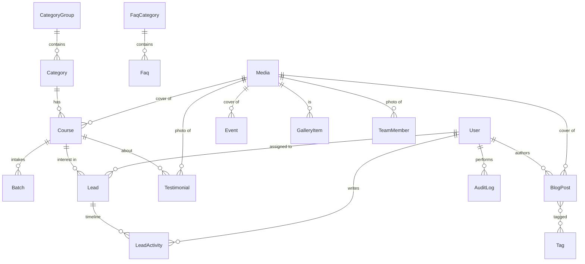

# 03 — Database Schema (PostgreSQL + Prisma)

Designed from the real data found in `src/content/*` (see `01`). The schema covers: **content** (courses, blog, events, FAQ, gallery, testimonials, team, settings), **CRM** (leads, contact messages, subscribers), and **operations** (users, media, audit log).

> 🔎 **Prisma 7 notes** (verify against current Prisma docs when you install):
> - Generator is `prisma-client` with an explicit `output` (not `prisma-client-js`).
> - `schema.prisma` has **no** `url` in the datasource; the URL is in `prisma.config.ts`.
> - A driver adapter is required: `npm i @prisma/client@7 @prisma/adapter-pg@7 pg dotenv` and `npm i -D prisma@7 tsx`.
> - ⚠️ **Pin the major version.** When this was checked (1 Oct 2026) npm's `latest` tag for `prisma` pointed to a **Prisma 8 release candidate** (`8.0.0-rc.x`), while the stable 7 line was at 7.10. A plain `npm i prisma` would install the RC. Stay on `@7` unless you deliberately choose to adopt 8 and re-read its migration notes.
> - The schema below was checked with Prisma 7.10's schema validator (no errors). Note: Prisma enums **must be written one value per line** — single-line `enum X { A B }` is a syntax error.
> - Environment files are **not** auto-loaded by `prisma.config.ts` → `import "dotenv/config"` at the top.

---

## 1. Entity-relationship overview


Standalone tables: `ContactMessage`, `Subscriber`, `SiteSetting`, `RateLimitHit`.

---

## 2. Prisma schema (`prisma/schema.prisma`)

```prisma
generator client {
  provider = "prisma-client"
  output   = "../src/generated/prisma"
}

datasource db {
  provider = "postgresql"
}

// ───────────── Enums ─────────────
enum Role {
  SUPER_ADMIN
  ADMIN
  EDITOR
  COUNSELOR
}
enum PublishStatus {
  DRAFT
  PUBLISHED
  ARCHIVED
}
enum CourseLevel {
  BEGINNER
  BEGINNER_TO_INTERMEDIATE
  INTERMEDIATE
  ADVANCED
}
enum LearningMode {
  PHYSICAL
  ONLINE
  HYBRID
}
enum TimeSlot {
  MORNING
  DAY
  EVENING
  WEEKEND
}
enum PreferredBatch {
  MORNING
  DAY
  EVENING
  WEEKEND
  ANY
}
enum BatchStatus {
  UPCOMING
  OPEN
  FULL
  RUNNING
  COMPLETED
  CANCELLED
}
enum LeadStatus {
  NEW
  CONTACTED
  COUNSELING_DONE
  DEMO_SCHEDULED
  ENROLLED
  LOST
  SPAM
}
enum LeadSource {
  WEBSITE_INQUIRY
  CONTACT_FORM
  WHATSAPP
  PHONE
  WALK_IN
  EVENT
  REFERRAL
  OTHER
}
enum LeadActivityType {
  NOTE
  CALL
  STATUS_CHANGE
  ASSIGNMENT
  FOLLOW_UP
}
enum MessageStatus {
  NEW
  READ
  REPLIED
  ARCHIVED
  SPAM
}
enum SubscriberStatus {
  ACTIVE
  UNSUBSCRIBED
}
enum EventCategory {
  WORKSHOP
  SEMINAR
  OPEN_HOUSE
  CERTIFICATION
  OTHER
}
enum EventStatus {
  DRAFT
  PUBLISHED
  CANCELLED
}
enum GalleryCategory {
  CAMPUS
  LABS
  EVENTS
  CLASSES
  CERTIFICATIONS
}
enum MediaSource {
  UPLOAD
  EXTERNAL
}
// ───────────── Users & auth ─────────────
// The auth library (Better Auth / Auth.js) adds Session, Account and Verification
// tables — generate them with the library's CLI and merge here.
model User {
  id            String    @id @default(cuid())
  name          String
  email         String    @unique
  emailVerified Boolean   @default(false)
  image         String?
  role          Role      @default(EDITOR)
  isActive      Boolean   @default(true)
  lastLoginAt   DateTime?
  createdAt     DateTime  @default(now())
  updatedAt     DateTime  @updatedAt

  assignedLeads Lead[]
  activities    LeadActivity[]
  posts         BlogPost[]
  media         Media[]
  auditLogs     AuditLog[]
}

// ───────────── Media ─────────────
model Media {
  id           String      @id @default(cuid())
  source       MediaSource @default(UPLOAD)  // EXTERNAL = seeded stock URLs
  url          String
  publicId     String?                       // Cloudinary public_id (for delete/transform)
  alt          String      @default("")
  width        Int?
  height       Int?
  bytes        Int?
  mimeType     String?
  folder       String?
  uploadedById String?
  uploadedBy   User?       @relation(fields: [uploadedById], references: [id], onDelete: SetNull)
  createdAt    DateTime    @default(now())

  courses      Course[]
  posts        BlogPost[]
  events       Event[]
  gallery      GalleryItem[]
  testimonials Testimonial[]
  team         TeamMember[]

  @@index([createdAt])
}

// ───────────── Courses ─────────────
model CategoryGroup {            // the 6 UI filter groups from constants.ts
  id         String     @id @default(cuid())
  slug       String     @unique  // basic-computer, programming, data-science, graphics-design, digital-marketing, special
  label      String
  sortOrder  Int        @default(0)
  categories Category[]
}

model Category {                 // the 15 categories
  id          String        @id @default(cuid())
  slug        String        @unique
  name        String        @unique
  description String?
  sortOrder   Int           @default(0)
  isActive    Boolean       @default(true)
  groupId     String
  group       CategoryGroup @relation(fields: [groupId], references: [id])
  courses     Course[]

  @@index([groupId])
}

model Course {
  id                     String        @id @default(cuid())
  slug                   String        @unique
  status                 PublishStatus @default(DRAFT)

  title                  String
  tagline                String
  shortDescription       String
  overview               String?
  categoryId             String
  category               Category      @relation(fields: [categoryId], references: [id])

  level                  CourseLevel
  durationWeeks          Int                       // display as "N Weeks"
  learningModes          LearningMode[]
  timeSlots              TimeSlot[]
  batchFrequency         String?                   // "Every Week" / "Every Sunday" (later: derived from Batch)
  targetStudents         String
  prerequisites          String?

  instituteCertificate   String                    // Certificate / Professional Certificate / Diploma …
  industryCertifications String[]                  // ["Google","Meta"]
  internship             String?
  seatsNote              String?
  feeNPR                 Int
  feeNote                String?

  skillsGained           String[]
  softwareTools          String[]
  portfolioProjects      String[]
  careerOpportunities    String[]
  learningObjectives     String[]

  ctaText                String?
  seoTitle               String?
  seoDescription         String?
  coverId                String?
  cover                  Media?        @relation(fields: [coverId], references: [id], onDelete: SetNull)

  isFeatured             Boolean       @default(false)
  featuredOrder          Int?
  sortOrder              Int           @default(0)
  publishedAt            DateTime?
  createdAt              DateTime      @default(now())
  updatedAt              DateTime      @updatedAt

  batches                Batch[]
  leads                  Lead[]
  testimonials           Testimonial[]

  @@index([status, categoryId])
  @@index([isFeatured, featuredOrder])
}

model Batch {                    // Phase 7 (optional) — makes "new batch" real and trackable
  id         String      @id @default(cuid())
  courseId   String
  course     Course      @relation(fields: [courseId], references: [id], onDelete: Cascade)
  name       String                     // "Batch 25 – Evening"
  startDate  DateTime    @db.Date
  timeSlot   TimeSlot
  seatsTotal Int
  seatsTaken Int         @default(0)
  status     BatchStatus @default(UPCOMING)
  createdAt  DateTime    @default(now())
  updatedAt  DateTime    @updatedAt

  @@index([courseId, startDate])
}

// ───────────── CRM ─────────────
model Lead {                     // admission enquiries
  id             String         @id @default(cuid())
  fullName       String
  phone          String
  email          String?
  courseId       String?
  course         Course?        @relation(fields: [courseId], references: [id], onDelete: SetNull)
  courseTitle    String?                        // snapshot — survives course rename/delete
  preferredBatch PreferredBatch @default(ANY)
  message        String?
  source         LeadSource     @default(WEBSITE_INQUIRY)
  status         LeadStatus     @default(NEW)
  assignedToId   String?
  assignedTo     User?          @relation(fields: [assignedToId], references: [id], onDelete: SetNull)
  lostReason     String?
  followUpAt     DateTime?

  // attribution — shows which campaign / social channel produced the lead
  utmSource      String?
  utmMedium      String?
  utmCampaign    String?
  referrerUrl    String?

  consentAt      DateTime?                      // time the visitor accepted the privacy notice
  ipHash         String?                        // salted hash, NOT the raw IP
  createdAt      DateTime       @default(now())
  updatedAt      DateTime       @updatedAt

  activities     LeadActivity[]

  @@index([status, createdAt])
  @@index([assignedToId, status])
  @@index([phone])
  @@index([courseId])
}

model LeadActivity {
  id        String           @id @default(cuid())
  leadId    String
  lead      Lead             @relation(fields: [leadId], references: [id], onDelete: Cascade)
  actorId   String?
  actor     User?            @relation(fields: [actorId], references: [id], onDelete: SetNull)
  type      LeadActivityType
  body      String?
  meta      Json?                              // e.g. { from: "NEW", to: "CONTACTED" }
  createdAt DateTime         @default(now())

  @@index([leadId, createdAt])
}

model ContactMessage {
  id           String        @id @default(cuid())
  name         String
  email        String
  phone        String?
  subject      String
  organization String?
  message      String
  status       MessageStatus @default(NEW)
  ipHash       String?
  createdAt    DateTime      @default(now())
  handledAt    DateTime?

  @@index([status, createdAt])
}

model Subscriber {
  id             String           @id @default(cuid())
  email          String           @unique
  status         SubscriberStatus @default(ACTIVE)
  source         String?
  createdAt      DateTime         @default(now())
  unsubscribedAt DateTime?
}

// ───────────── Content ─────────────
model BlogPost {
  id             String        @id @default(cuid())
  slug           String        @unique
  status         PublishStatus @default(DRAFT)
  title          String
  excerpt        String
  contentMd      String                           // Markdown, NOT MDX
  coverId        String?
  cover          Media?        @relation(fields: [coverId], references: [id], onDelete: SetNull)
  authorId       String?
  author         User?         @relation(fields: [authorId], references: [id], onDelete: SetNull)
  authorName     String?                          // display override, e.g. "DarbarTech Trainer"
  readingMinutes Int           @default(1)
  seoTitle       String?
  seoDescription String?
  publishedAt    DateTime?
  createdAt      DateTime      @default(now())
  updatedAt      DateTime      @updatedAt
  tags           Tag[]

  @@index([status, publishedAt])
}

model Tag {
  id    String     @id @default(cuid())
  name  String     @unique
  slug  String     @unique
  posts BlogPost[]
}

model Event {
  id               String        @id @default(cuid())
  slug             String        @unique
  status           EventStatus   @default(DRAFT)
  title            String
  category         EventCategory
  startsAt         DateTime                      // "upcoming" = startsAt > now(), computed in queries
  endsAt           DateTime?
  location         String
  shortDescription String
  fullDescription  String
  coverId          String?
  cover            Media?        @relation(fields: [coverId], references: [id], onDelete: SetNull)
  registrationUrl  String?
  capacity         Int?
  createdAt        DateTime      @default(now())
  updatedAt        DateTime      @updatedAt

  @@index([status, startsAt])
}

model FaqCategory {
  id        String @id @default(cuid())
  name      String @unique
  sortOrder Int    @default(0)
  faqs      Faq[]
}

model Faq {
  id          String      @id @default(cuid())
  categoryId  String
  category    FaqCategory @relation(fields: [categoryId], references: [id], onDelete: Cascade)
  question    String
  answer      String
  sortOrder   Int         @default(0)
  isPublished Boolean     @default(false)

  @@index([categoryId, sortOrder])
}

model GalleryItem {
  id          String          @id @default(cuid())
  mediaId     String
  media       Media           @relation(fields: [mediaId], references: [id])
  title       String?
  alt         String
  category    GalleryCategory
  takenAt     DateTime?
  sortOrder   Int             @default(0)
  isPublished Boolean         @default(true)

  @@index([category, sortOrder])
}

model Testimonial {
  id           String   @id @default(cuid())
  name         String
  courseId     String?
  course       Course?  @relation(fields: [courseId], references: [id], onDelete: SetNull)
  courseLabel  String?
  quote        String
  rating       Int      @default(5)
  photoId      String?
  photo        Media?   @relation(fields: [photoId], references: [id], onDelete: SetNull)
  consentGiven Boolean  @default(false)          // site code says: never publish without consent
  consentNote  String?
  isPublished  Boolean  @default(false)
  sortOrder    Int      @default(0)
  createdAt    DateTime @default(now())
}

model TeamMember {
  id          String  @id @default(cuid())
  name        String
  role        String
  specialty   String?
  bio         String?
  photoId     String?
  photo       Media?  @relation(fields: [photoId], references: [id], onDelete: SetNull)
  sortOrder   Int     @default(0)
  isPublished Boolean @default(false)
}

// ───────────── Settings & ops ─────────────
model SiteSetting {            // key → validated JSON (see section 4)
  key         String   @id
  value       Json
  updatedAt   DateTime @updatedAt
  updatedById String?
}

model AuditLog {
  id         String   @id @default(cuid())
  actorId    String?
  actor      User?    @relation(fields: [actorId], references: [id], onDelete: SetNull)
  actorEmail String?
  action     String                       // "course.update", "lead.status_change", "user.create"
  entity     String                       // "Course"
  entityId   String?
  summary    String?
  meta       Json?
  createdAt  DateTime @default(now())

  @@index([createdAt])
  @@index([entity, entityId])
}

model RateLimitHit {            // simple DB-backed rate limit for public forms
  id        String   @id @default(cuid())
  key       String                       // "inquiry:<ipHash>"
  createdAt DateTime @default(now())

  @@index([key, createdAt])
}
```

---

## 3. Design notes

| Decision | Reason |
|----------|--------|
| `String[]` columns for skills/tools/projects/careers/objectives | They are simple ordered lists, always read together with the course, never queried individually → no need for join tables. Postgres arrays are supported by Prisma. |
| `learningModes` / `timeSlots` as enum arrays | Today they are strings like `"Physical / Online / Hybrid"`; enum arrays make filtering possible. A formatter turns them back into the same label. |
| `industryCertifications String[]` | Source has `"Google, Meta"` strings → split once at seed time. |
| `Lead.courseTitle` snapshot | Reports stay meaningful if a course is renamed or archived. |
| `Lead.ipHash` instead of IP | Enough for spam detection, avoids storing raw IPs. |
| `Event.startsAt` instead of `upcoming` flag | Fixes P7: the flag goes stale. |
| `Testimonial.consentGiven` | The codebase repeatedly warns "do not publish without student consent" — the admin action refuses to publish otherwise. |
| `Media.source = EXTERNAL` | Lets the seed script keep today's Pexels URLs working while editors gradually replace them with real uploads. |
| `SiteSetting` as JSON | Small, rarely-queried groups (contact, hours, socials, stats…) don't deserve a table each; Zod validates the shape on write. |
| Status enums instead of deletes | Safe editing: draft → published → archived. |
| No student/payment tables | Student portal is out of scope for v1 (see `04`, Phase 8). |

## 4. `SiteSetting` keys and their JSON shape

| Key | Shape (validated with Zod) | Replaces |
|-----|----------------------------|----------|
| `general` | `{ name, shortName, tagline, description, siteUrl, logoMediaId, twitterHandle }` | `SITE_CONFIG` |
| `contact` | `{ phone, whatsapp, email, address, mapQuery, notifyEmail }` | `institute.contact` + hard-coded `mailto:` |
| `hours` | `[{ day, time }]` | `institute.hours` |
| `socials` | `[{ name, url, icon }]` | `institute.socials` |
| `about` | `{ story, mission, vision, campusMediaId }` | `institute.about`, `ABOUT_CAMPUS_IMAGE` |
| `stats` | `[{ label, value }]` (**no placeholder values allowed to publish**) | `institute.stats` |
| `whyChooseUs` | `[{ title, description, icon }]` | `institute.whyChooseUs` |
| `facilities` | `string[]` | `institute.facilities` |
| `everyCourseIncludes` | `string[]` | `EVERY_COURSE_INCLUDES` |

## 5. Indexing & search

- Indexes above cover the main admin filters (lead status/date/assignee, published content by date).
- Course search on `/courses?q=` currently matches title, category, skills, careers in the browser. Keep that for ≤ ~150 courses; later move to Postgres `ILIKE` or full-text search (`tsvector`) / `pg_trgm`.

## 6. Future-proofing (decide now, build later)

- **Nepali / bilingual content:** if wanted, add a translations table per content type (e.g. `CourseTranslation { courseId, locale, title, tagline, … }`) rather than `titleNe` columns. Cheap to plan now, painful to retrofit.
- **Student portal:** future tables `Student`, `Guardian`, `Enrollment (studentId, batchId)`, `Payment`, `Attendance`, `Certificate`. `Batch` (already here) is the anchor. Do not start until the admin panel is stable.
- **Online payments** (eSewa, Khalti, bank transfer): attach to `Enrollment`, not `Lead`.

## 7. Migration workflow

```bash
npx prisma migrate dev --name init        # create + apply locally, generates client
npx prisma generate                       # regenerate client after schema edits
npx prisma migrate deploy                 # production / CI (never `migrate dev` in prod)
npx prisma db seed                        # runs prisma/seed.ts (see 07)
npx prisma studio                         # visual DB browser for development
```
Rules: one migration per schema change, committed to git; never edit an applied migration; take a database backup before any production migration.
